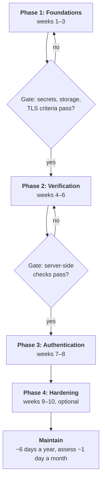

# Part 11: Making the case and running the program

Everything before this part is for engineers. This part is for the conversation where you ask for time and budget, and for the plan you run once you get it.

**If you're a stakeholder rather than an engineer, you can read this part on its own.** Start with the one-page executive summary below. Chapters 29 and 30 give you the risk and the regulatory position, Chapter 31 shows what comparable teams do, and Chapter 32 is the plan, with costs, phases, owners, and success criteria. I explain technical terms where they first appear. The § references point to the engineering chapters if you want the detail; you don't need them to follow the argument.

**If you're the engineer making the case,** the most useful thing in this part is §29.4: how to work out your *own* exposure instead of quoting an industry average. Security people lose credibility by quoting averages, and you only get to lose it once.

## Executive summary

**The ask.** Approve a ten-week mobile security program in four phases, and name one owner for each line in §32.4. Approve Phase 1 now. Start each later phase only when the previous one meets its success criteria (§32.5).

**The cost.** About **18–26 engineering days** in total across Android, iOS, and backend, spread over ten calendar weeks alongside feature work. After that, plan about **6 engineering days a year** for maintenance and **about 1 day a month** for self-assessment. All three are planning estimates, not measurements (§32.3). You pay no license fees: every control uses platform features or free tools.

**The risk it reduces.** Four things, roughly in order of likelihood *(reasoned)*:

1. A leaked credential: an API key (a secret string that lets software use a paid or private service) or a password, shipped inside the app or exposed by the build pipeline, the automated system that builds and signs each release. This is the most common mobile failure, and the cheapest to fix.
2. Account takeover and fraud. An attacker steals a user's session token (the credential the app holds after sign-in) and reuses it from their own device, or runs scripts that abuse payment and promotion flows.
3. A personal-data breach, which brings legal duties to notify regulators and users, and possible fines.
4. A missed regulatory or app-store deadline, which can stop you shipping updates.

For scale, the average data breach in IBM's 2026 study cost **$4.99 million**, a record. Your own exposure is almost certainly different, and §29.4 shows how to work it out instead of borrowing that number.

**Why now.** Several external deadlines have arrived or are close:

| Date | What happens | Who it affects |
|---|---|---|
| **2 Aug 2026** (in force) | EU AI Act transparency duties (Article 50); systems already on the market have until 2 Dec 2026 to mark AI-generated content | Apps with chatbots or AI-generated content used in the EU |
| **31 Aug 2026** (in force) | Google Play: new apps and updates must target Android 16 (API level 36); extensions available to 1 Nov 2026 | Every Android phone and tablet app on Play (Wear OS, TV, Automotive OS, and XR apps have lower minimums) |
| **11 Sep 2026** (in force) | EU Cyber Resilience Act: manufacturers must report actively exploited vulnerabilities and severe incidents, with a first warning within **24 hours** | Commercial apps offered in the EU, including ones already on the market |
| **30 Sep 2026** (in force) | Android developer verification: apps must come from a developer registered with Google. Starts in Brazil, Indonesia, Singapore, and Thailand; global from 2027 | Installs from Play and six partner stores on certified devices in those four countries; from 2027, all apps, including sideloaded ones (installed from outside an app store) |
| **11 Dec 2027** | EU Cyber Resilience Act applies in full: secure-by-default design, vulnerability handling, security updates | Commercial apps offered in the EU |

**The timeline.** Four phases. Each delivers something testable on its own, so the program survives a pause (§32.2):

| Phase | Weeks | Delivers |
|---|---|---|
| 1: Foundations | 1–3 | No live secrets in code or builds; sign-in tokens kept in hardware-backed storage (a protected area of the phone's chip that won't release keys to other software); correctly configured encryption between app and server |
| 2: Verification | 4–6 | Your server can tell a genuine app on a genuine device from a script |
| 3: Authentication | 7–8 | Payments and account changes need a real biometric confirmation (fingerprint or face) |
| 4: Hardening | 9–10 | Signs that someone is modifying the app at runtime are reported to the server; release builds are harder to read |

**The decision needed.**

| Option | Effort *(estimate)* | What you get | What you accept |
|---|---|---|---|
| **A. Do nothing** | 0 days | Nothing | Leaked keys stay live; fraud controls rely on the app, which attackers control; no evidence for auditors or for the reporting the EU Cyber Resilience Act (CRA) requires |
| **B. Phase 1 only** | ~6–8 days | The minimum it's irresponsible to skip (§32.7, the minimum viable product question) | No server-side way to spot scripted abuse or cloned apps |
| **C. Phases 1–3** *(recommended minimum for apps with payments or personal data)* | ~15–22 days | Secrets, storage, device verification, and real step-up authentication (an extra check, such as a biometric, before a high-value action, which an attacker can't skip by modifying the app) | Weaker defense against casual reverse engineering (someone taking the app apart to read or change it) |
| **D. Full program** | ~18–26 days | All of the above, plus tamper reporting and build hardening | Phase 4 has the lowest return per day; cut it first if squeezed |

You're being asked to decide **which option, who owns each line in §32.4, and the date Phase 1 starts.**

---

## Chapter 29: The business case

In 2022 the security firm CloudSEK scanned mobile apps and found **3,207** of them shipping Twitter API keys inside the app, 230 of them with the full set of credentials needed to take over the linked accounts *(reported)* ([The Hacker News](https://thehackernews.com/2022/08/researchers-discover-nearly-3200-mobile.html)). Nobody had to break in. The keys were in the download. Most mobile security failures look like this: not a sophisticated attack, but something the team shipped by accident and nobody checked. This chapter turns that kind of risk into a case a budget holder can weigh.

### 29.1 Why mobile, and why now

For many customers, your mobile app is the main way they reach you. It's also the most exposed part of your system, for one structural reason: **the app runs on hardware you don't control.** Your servers sit in a data center you or your cloud provider control. Your app sits in the hands of anyone who downloads it, including anyone who wants to take it apart, change it, or drive it from a script. Treat anything shipped inside the app as public: keys, business rules, and "hidden" endpoints (server addresses the app calls but doesn't advertise). Chapter 1 covers what that means technically.

The "now" is partly the numbers in §29.2 and partly the calendar. The EU Cyber Resilience Act's reporting duty has applied since 11 September 2026. Google Play's new target-level rule, which sets how recent an Android version each app must declare it's built for, has applied since 31 August 2026. Android developer verification started on 30 September 2026 (Chapter 30). Each of those turns a security gap into a deadline.

### 29.2 What the current numbers say

The figures below come from three annual reports, each the latest edition as of October 2026:

- IBM's *Cost of a Data Breach Report 2026*, researched by the Ponemon Institute and released 29 July 2026. It covers 602 organizations breached between March 2025 and February 2026 ([IBM report](https://www.ibm.com/reports/data-breach), [IBM press release](https://newsroom.ibm.com/2026-07-29-ibm-study-one-in-four-malicious-breaches-are-ai-enabled,-costing-companies-6-million-on-average)).
- Verizon's *2026 Data Breach Investigations Report* (DBIR), released 19 May 2026 ([Verizon](https://www.verizon.com/about/news/breach-industry-wide-dbir-finds)).
- GitGuardian's *State of Secrets Sprawl 2026*, published 17 March 2026 ([GitGuardian](https://blog.gitguardian.com/the-state-of-secrets-sprawl-2026/)).

A **secret**, in this table, means a credential that software uses rather than a person: an API key, a token, a password, or a signing key.

| Finding | Figure | Source |
|---|---|---|
| Global average cost of a breach | **$4.99M**, up 12% on 2025 and a record | IBM |
| United States average | **$11.5M** per breach at US organizations, more than double the global figure | IBM |
| Healthcare | **$6.64M**, costliest sector for the 13th year running, though down 10.5% from $7.42M *(reported)* | IBM, via [HIPAA Journal](https://www.hipaajournal.com/2026-cost-data-breach-study-ibm/) |
| Financial services | **$6.3M**, second | IBM |
| Mean time to identify and contain | **247 days**, the first rise after five years of improvement (up from 241 *(reported)*) | IBM |
| AI-enabled breaches | **One in four** malicious breaches, up 56% on the year, averaging **$6M** | IBM |
| Ransomware | Reported by **39%** of breached organizations, up from 34% the year before | IBM |
| Customer personal data | Stolen in **52%** of breaches, at **$192 per record** *(reported)* | IBM, via secondary summaries |
| How breaches start | Exploited vulnerabilities **31%**, overtaking stolen credentials for the first time in the report's 19 years; third parties involved in **48%** | Verizon |
| Mobile-first scams | Social engineering by text message and voice call succeeded **40% more often** than email phishing | Verizon |
| New secrets leaked on public GitHub | **28.65 million** in 2025, up 34%, the largest one-year jump recorded | GitGuardian |
| Secrets never revoked | More than **64%** of secrets confirmed valid in 2022 were still valid when retested in January 2026 | GitGuardian |
| One AI coding assistant | Commits made with **Claude Code** leaked secrets at **3.2%**, against a **1.5%** baseline for all public commits | GitGuardian |

**Read the trend, not only the headline.** IBM's global average was $4.88M in 2024. It *fell* to $4.44M in 2025, the first decline in five years, then rose to a record in 2026. A document that quotes $4.88M today is two reports behind. One that cites the 2025 fall as proof that things are improving is one report behind.

**Quote the GitGuardian AI figure exactly.** It's about one tool, whose commits GitGuardian could identify by the co-author line the tool adds to them. GitGuardian compared those commits with all public commits, not with "human-only" commits, and its own caveat is that developers still decide what to accept and push. The honest conclusion is that AI-assisted code needs the same secret scanning as everything else, not that AI tools double your leak rate.

**Three findings deserve extra weight in a mobile conversation.**

- **247 days.** A breach you haven't noticed is the normal case. That argues for server-side monitoring and logging, which see every client, over client-side controls, which an attacker can remove from their copy of the app.
- **The secrets figures.** They're about your build pipeline and your app package, which Part 6 covers. The 64% figure also says the industry is good at leaking secrets and bad at rotating them (replacing a leaked secret with a new one and disabling the old one).
- **Mobile-first scams.** Attackers phish your users by text more successfully than by email. That's a reason to stop treating SMS one-time codes and texted links as strong proof of identity for high-value actions. Prefer passkeys (sign-in keys stored on the user's device that a fake website can't trick out of them) or biometrics bound to a cryptographic key (§11.7).

### 29.3 What you are risking, with real precedents

Abstract risk doesn't get funded. Each row below pairs a category of risk with something that happened and was publicly documented.

| Risk | What it looks like | A documented precedent |
|---|---|---|
| **Leaked credentials in the app** | API keys or cloud credentials shipped inside the app package or left in the build pipeline | CloudSEK, 2022: **3,207** apps leaking Twitter API keys *(reported)*. GitGuardian 2026: most leaked secrets are never rotated |
| **Account takeover** | Attackers reuse stolen tokens from their own devices; you pay in fraud losses, remediation cost, and support load | Verizon 2026: stolen credentials lost the top spot as the way attackers get in, for the first time in the report's 19 years, and text and voice scams outperform email |
| **Payment and promotion fraud** | Attackers abuse business logic at scale: replayed requests, manipulated amounts, scripted sign-up bonuses | Financial services is second on breach cost, at $6.3M (IBM 2026) |
| **Data breach** | Personal data exposed through storage, logging, an insecure API, or a leaked credential | Global average $4.99M; customer personal data at $192 per record *(reported)* |
| **Regulatory penalty** | Fines of up to 4% of global annual turnover or €20M, whichever is higher, under the EU's General Data Protection Regulation (GDPR) | **Meta: €1.2 billion**, Irish Data Protection Commission, May 2023, still the largest GDPR fine in January 2026. It was for transferring EU users' data to the US without adequate safeguards; Meta appealed. Cumulative GDPR fines reached **€7.1 billion** by January 2026 ([DLA Piper](https://blogs.dlapiper.com/advocatus/files/2026/01/dla-piper-gdpr-fines-and-data-breach-survey-2026.pdf)) |
| **Private litigation** | Class actions that rival regulators in size | **Capital One**: $190 million class-action settlement (2019 breach, approved 2022), on top of an **$80 million** penalty from its US banking regulator, the OCC, in August 2020 ([OCC](https://www.occ.gov/news-issuances/news-releases/2020/nr-occ-2020-101.html)). **T-Mobile**: $350 million settlement (2021 breach, approved 2023), plus a commitment to spend $150 million more on security. **Equifax**: at least $575 million, potentially $700 million, with the US Federal Trade Commission (FTC), the Consumer Financial Protection Bureau (CFPB), and 50 states and territories (2017 breach) ([FTC](https://www.ftc.gov/news-events/news/press-releases/2019/07/equifax-pay-575-million-part-settlement-ftc-cfpb-states-related-2017-data-breach)) |
| **Reputation** | Churn, acquisition cost, brand damage | IBM 2026: **41%** of ransomware incidents involved threats against brand reputation, such as public shaming and leaks |

Three honesty notes on this table, because someone will challenge you on it.

**The Meta fine was about data transfers, not a mobile security failure.** It's the right example for the *scale* of regulatory risk. It's the wrong example for "this is what happens if we skip certificate pinning" (a control that makes the app accept only the server certificates or keys you choose). Use it precisely or someone will correct you.

**Capital One shows the two exposures are separate.** The $190 million was a settlement with customers; the $80 million was a regulator's penalty. You can face both for the same incident.

**Equifax was a combined settlement.** Most of it funds consumer compensation, but it was negotiated with regulators, not won in a class action. Quote it as "regulators and states", not as "litigation".

### 29.4 How to scope your own exposure — do this instead of quoting averages

This is the most important section in the chapter.

An industry average comes from large organizations, with large legal teams, wide notification duties, and large breach volumes. A mobile incident at a mid-sized company usually costs far less. **If you present the average as your exposure, someone eventually notices, and from then on every request you make gets discounted.**

So derive your own number. You need five inputs, and your organization already has most of them:

| Input | What it means | Who has it |
|---|---|---|
| **Users affected** | Not your install base, but the people an attacker can reach through the specific weakness. "Tokens readable on rooted devices" (phones whose owner has removed the operating system's protections, called "rooting" on Android and "jailbreaking" on iOS) doesn't mean all users | Analytics: active users of the affected feature or version |
| **Notification cost** | Per-user cost of notifying and, if needed, credit monitoring | Compliance or legal, or a vendor quote |
| **Response cost** | Engineering days to investigate and fix, the forced release and store review, support contacts, any forensic help | Your team's day rate; support's cost per contact |
| **Fraud losses** | What the weakness lets an attacker take, per affected account | Fraud or finance: historical loss rate for that flow |
| **Regulatory exposure** | The penalty framework that applies, and the reporting clock | Whoever owns compliance |

Two cautions on the last row. First, a fine expressed as a percentage of turnover is a ceiling, not a forecast. Second, the reporting clocks are short. Under GDPR, you notify the supervisory authority (the national data-protection regulator) within **72 hours** of becoming aware of a breach that risks people's rights. You notify the affected people "without undue delay" when the risk is high (Articles 33 and 34). Under the Cyber Resilience Act, the first warning is due within **24 hours** (§30.1). Those clocks are why response cost is real and near-term.

**A worked example.** The numbers below are *illustrative*, not data. Replace every one with your own.

| Step | Illustrative input | Result |
|---|---|---|
| Weakness | Refresh tokens (long-lived credentials the app uses to get new sign-in tokens) stored in plain files; readable on rooted phones or from unencrypted backups | — |
| Users reachable | 400,000 active users × a share you estimate for rooted or backed-up devices, say 3% | 12,000 users |
| Notification | 12,000 × $2 per user | $24,000 |
| Response | 15 engineering days × $800, plus 1,200 support contacts × $6 | $19,200 |
| Fraud | 0.5% of reachable accounts abused × $300 average loss | $18,000 |
| **Total** | | **≈ $61,000**, before any regulatory penalty |
| What reduces it | Phase 1 (§32.2) moves tokens to hardware-backed storage | Most of it |

Then say it like this:

> "The industry average cost of a breach is $4.99 million. That isn't our exposure. Ours is approximately X, derived as follows, and here's what reduces it."

That sentence is more persuasive than any borrowed statistic, because it survives scrutiny.

> **Trap:** inventing ranges. Any "$50,000 to $500,000 per incident" figure you've seen is an estimate someone made up and everyone repeated. If you need a range, derive a low and a high case from your own inputs and show your working.

### 29.5 The return side, stated carefully

The strongest honest argument isn't a single return-on-investment number. It's three points.

**Prevention is cheap relative to response.** Chapter 32 estimates the program at 18–26 engineering days. Compare that with the response cost you derived in §29.4. For most teams, preventing one moderate incident pays for the program *(reasoned)*. Say "for most teams" rather than presenting it as certain.

**Detection time drives cost.** With the mean time to identify and contain a breach at 247 days and rising, monitoring and logging aren't overhead. IBM also reports that breaches lasting more than 200 days cost nearly a third more (about 31%) than shorter ones *(reported)*. Of the factors in the report, detection time has the clearest link to cost.

**Some of this isn't optional.** Where a regulator, an auditor, or an app store requires a control, the business case is compliance, not risk reduction, and arguing risk numbers wastes everyone's time. Before you walk into the room, know which of your controls fall into which category (§30.3).

**Key takeaways**

- Use the current editions: IBM 2026 ($4.99M global, $11.5M US, 247 days), Verizon 2026, GitGuardian 2026.
- Quote precisely. The Meta fine was about data transfers; the 3.2% AI figure is about one tool against all public commits.
- Your exposure is a calculation from your own inputs, not an industry average.
- The return is prevention versus your own response cost, plus the controls you're required to have anyway.

**Try it**

1. Fill in the §29.4 worked example for one real weakness in your app. Mark every input you had to guess as *(estimate)*, and ask the owner of each input to confirm it.
2. Find the last security business case your organization wrote. Check the edition year of every statistic in it against §29.2.

---

## Chapter 30: The regulatory landscape

On 11 September 2026 a new rule started applying to every manufacturer that sells a product with digital elements in the EU, mobile apps included: if someone is actively exploiting a vulnerability in your product, you have **24 hours** to send an early warning to the authorities. Most mobile teams heard about it afterwards. This chapter exists to break that pattern.

You don't need to be a lawyer. You do need to know which rules apply to you, who in your organization owns them, and what they require of your app. That last part is short. Nothing here is legal advice: confirm scope with whoever owns compliance.

### 30.1 The frameworks you are most likely to meet

These frameworks cover most situations. Find the rows that apply to you and ignore the rest.

| Framework | Applies when | What it requires of your app | Status, October 2026 |
|---|---|---|---|
| **GDPR** (EU/EEA) | You process personal data of people in the EU | A lawful basis for each use of personal data, data minimization (collect only what you need), purpose limitation (use it only for the stated purpose), rights of access and deletion, and breach notification to the supervisory authority within **72 hours** of becoming aware (Article 33). Fines up to **4% of global annual turnover or €20 million**, whichever is higher; failures in breach notification fall in the lower tier of **2% or €10 million** (Article 83) | In force since 2018. The European Commission's *Digital Omnibus* proposal of November 2025 would require notifying the authority only for "high risk" breaches and extend the deadline to 96 hours. It's **not law**: in October 2026 it was still awaiting a committee decision in the European Parliament ([Legislative Observatory](https://oeil.europarl.europa.eu/oeil/en/procedure-file?reference=2025/0360(COD))) |
| **EU Cyber Resilience Act (CRA)** | You make a commercial product with digital elements available in the EU. Standalone software is in scope, and so are commercial mobile apps, paid or free | Report actively exploited vulnerabilities and severe incidents through the Single Reporting Platform run by ENISA (the EU cybersecurity agency): early warning within **24 hours** of becoming aware, notification within **72 hours**, and a final report within 14 days of a fix being available (vulnerabilities) or within one month of the notification (incidents). From 11 Dec 2027: secure-by-default configuration, vulnerability handling including a software bill of materials (SBOM, a machine-readable list of the components in your app), and security updates. Fines up to **€15 million or 2.5%** of worldwide annual turnover, whichever is higher | Reporting applies **since 11 Sep 2026**, including to products already on the market (Article 69(3)). Full application **11 Dec 2027** ([EC reporting page](https://digital-strategy.ec.europa.eu/en/policies/cra-reporting), [Regulation (EU) 2024/2847](https://eur-lex.europa.eu/eli/reg/2024/2847/oj)) |
| **DORA** (Digital Operational Resilience Act, EU financial sector) | You're a bank, insurer, payment or e-money firm, investment firm, or similar, or a critical ICT (information and communication technology) provider to one | ICT risk management covering your apps; major-incident reporting, with an initial notice within 4 hours of classifying an incident as major and no later than 24 hours after becoming aware of it ([Delegated Regulation (EU) 2025/301](https://eur-lex.europa.eu/eli/reg_del/2025/301/oj)); resilience testing; third-party risk management | Applies since **17 Jan 2025** |
| **NIS2** (EU directive on network and information security) | You're an "essential" or "important" entity in a listed sector (for example energy, health, banking, digital infrastructure, or some digital providers) | Risk-management measures and incident reporting: early warning within 24 hours, notification within 72 hours, and a final report within one month of the notification. Each member state sets maximum fines of at least €10 million or 2% of turnover (essential entities) and €7 million or 1.4% (important entities) | The deadline for member states to turn it into national law was 17 Oct 2024. Most have done so. On 8 Jul 2026 the Commission referred Ireland, Spain, France, and the Netherlands to the EU Court of Justice for not doing so ([EC press release](https://ec.europa.eu/commission/presscorner/detail/en/ip_26_1499)). Check your country's law |
| **EU AI Act** | Your app offers AI features to people in the EU | Tell people when they're interacting with an AI system, and mark AI-generated content (Article 50). Some practices are banned outright. High-risk uses (for example credit scoring) carry heavier duties | Prohibitions since 2 Feb 2025; general-purpose model rules since 2 Aug 2025; Article 50 since **2 Aug 2026**, except that systems already on the market before that date have until **2 Dec 2026** to add machine-readable marking of AI-generated content (Article 50(2)). The AI Digital Omnibus ([Regulation (EU) 2026/1744](https://eur-lex.europa.eu/eli/reg/2026/1744/oj), in force 27 Jul 2026) moved high-risk duties to **2 Dec 2027** (standalone systems, Annex III) and **2 Aug 2028** (AI embedded in regulated products, Annex I). It also added new prohibitions that apply from 2 Dec 2026 ([Gibson Dunn summary](https://www.gibsondunn.com/eu-ai-act-omnibus-agreement-postponed-high-risk-deadlines-and-other-key-changes/)) |
| **PCI DSS** (Payment Card Industry Data Security Standard) | You store, process, or transmit payment card data | Protect cardholder data at rest and in transit, restrict access, require multi-factor authentication (MFA) into the systems that handle card data, log activity, and control the scripts on payment pages. Most apps avoid most of this by **tokenizing through a payment provider's SDK**: the provider's code library collects the card number and gives your app a substitute token, so card numbers never touch your app or servers. **That's the cheapest compliance decision available to you**; your acquirer (the bank that processes your card payments) or your assessor confirms the exact scope | **v4.0.1** is the only active version (v4.0 retired 31 Dec 2024). All 51 future-dated requirements became mandatory on **31 Mar 2025** ([PCI SSC](https://blog.pcisecuritystandards.org/now-is-the-time-for-organizations-to-adopt-the-future-dated-requirements-of-pci-dss-v4-x)). If the phone itself accepts card payments (tap to pay), PCI's separate MPoC (Mobile Payments on COTS, meaning commercial off-the-shelf devices) standard applies |
| **HIPAA** (US Health Insurance Portability and Accountability Act) | You're a covered entity (such as a health plan or care provider) or a business associate handling protected health information (PHI) for one | Safeguards for PHI, including access controls, audit trails, and breach notification. Encryption is currently "addressable" (you implement it, or document why it isn't reasonable and what you do instead), not mandatory | A proposed update (published 6 Jan 2025) would make encryption and MFA mandatory. It's **still a proposal**: the latest agenda of the US Department of Health and Human Services (HHS) lists it under long-term actions, with final action anticipated in July 2027 ([reginfo.gov](https://www.reginfo.gov/public/do/eAgendaViewRule?pubId=202510&RIN=0945-AA22)) |
| **FTC Health Breach Notification Rule** (US) | You run a health or wellness app that is *not* covered by HIPAA | Notify users, the FTC, and in some cases the media after a breach. A breach includes unauthorized sharing, not only hacking | Amended rule effective 29 Jul 2024 |
| **SOC 2** (an independent audit report on a service provider's security controls) | Enterprise or B2B customers ask for it | Access controls, audit logging, monitoring, and evidence that your controls operate over time. It's an audit of process, not a technical standard | Ongoing, annual |
| **Regional financial regulation** | You operate in a supervised market | Varies widely and often prescribes specific controls. Central-bank certification programs often test the app directly against a defined test suite | Check your regulator |
| **App-store policies** | Always | Data declarations that match actual behavior, a justification for each permission, no undisclosed tracking, and current SDKs and target levels (§30.2) | Changes several times a year |

> **Trap:** reading the CRA as "a 2027 problem". The full requirements apply from December 2027, but the reporting duty has applied since September 2026, and it covers apps you shipped years ago. If nobody in your company knows how to file a 24-hour early warning, you have a gap today.

### 30.2 Store policy is the fastest-moving regulator

Engineers consistently underrate this: **Apple and Google act in days, where a regulator takes years.** Each store asks you to declare what data your app collects and shares. If your declaration doesn't match the app's behavior, the store rejects or removes the app. If you miss a platform deadline, you can't ship updates. Both interrupt revenue now, rather than costing a fine later.

These current rules most often catch teams out:

| Store | Rule | Since |
|---|---|---|
| Google Play | **Data safety** section must match what the app and its SDKs (third-party code libraries bundled into the app) collect and share | 2022 |
| Google Play | New apps and updates must target **Android 16 (API level 36)**; existing apps must target API level 35 or higher to stay available to new users on newer devices; extensions available to 1 Nov 2026 ([Play Console Help](https://support.google.com/googleplay/android-developer/answer/11926878)) | 31 Aug 2026 |
| Android | **Developer verification**: apps installed from Play and six partner stores on certified devices in Brazil, Indonesia, Singapore, and Thailand must come from a verified developer; from 2027, all apps on certified devices worldwide, including those distributed outside Play ([Android developers](https://developer.android.com/developer-verification)) | 30 Sep 2026 |
| Apple App Store | **Privacy labels** must match behavior; **privacy manifests** declare data use and the approved reasons for using certain APIs, including in third-party SDKs | Manifests enforced since 1 May 2024 |
| Apple App Store | Uploads must be built with **Xcode 26** and the iOS 26 SDK or later ([Apple](https://developer.apple.com/news/upcoming-requirements/)) | 28 Apr 2026 |
| Apple App Store | iOS and iPadOS uploads must target **iOS 13 or later** (minimum deployment target) ([Apple](https://developer.apple.com/news/upcoming-requirements/)) | 9 Sep 2026 |

§18.3 covers the engineering consequence: you can't declare accurately unless you know what leaves the device. To find out, capture your own app's network traffic and check it against your declaration. On Android, `MASTG-TEST-0206` ("Undeclared PII in Network Traffic Capture") is the test; MASTG is the OWASP Mobile Application Security Testing Guide, and PII means personally identifiable information. The result routinely surprises teams, usually because of a third-party SDK (§18.4).

### 30.3 How to use this chapter

Take three actions, in order.

**Find the owner.** Someone in your organization already owns compliance. Find them before you design a feature that touches regulated data, not after. A fifteen-minute conversation occasionally prevents a nine-month remediation.

**Map your controls to their requirements.** When a control exists because a regulator or a store requires it, label it that way in your own planning. The label changes how the prioritization conversation goes.

**Separate "required" from "advisable".** Proposals that mix them get cut wholesale. If three of your ten items are mandatory, say so and defend the other seven on their merits.

### 30.4 Where the plan meets the rules

Most of what these frameworks ask of a mobile app maps onto the program in Chapter 32. Use this table to label each phase's items as "required" or "advisable" for your situation.

| Requirement | Frameworks that ask for it | Where the plan delivers it |
|---|---|---|
| Protect personal and payment data at rest and in transit | GDPR, PCI DSS, HIPAA, DORA, CRA | Phase 1: hardware-backed token storage, TLS configuration (TLS is the encryption that protects traffic between app and server) |
| Strong authentication for sensitive actions | PCI DSS (MFA), DORA, proposed HIPAA update | Phase 3: biometrics bound to keys, step-up authentication |
| Detect and report incidents quickly | GDPR (72 h), CRA (24 h), DORA (4/24 h), NIS2 (24 h) | Phase 2: server-side logging of device-check results and risk scoring; §32.4 names who files the report; Chapter 24 is the incident runbook |
| Know what is in your app, and fix vulnerabilities | CRA (vulnerability handling, SBOM from 2027), PCI DSS | Phase 1: commit scanning (a check that blocks any code change containing a secret); Part 6: tracking dependencies and proving how each build was made |
| Declarations that match behavior | App stores, GDPR | §30.2 traffic check; §32.4 names the owner |

**Key takeaways**

- The CRA's 24-hour reporting duty has applied to commercial apps in the EU since 11 September 2026, including apps already on the market.
- Tokenizing payments through a provider is the cheapest compliance decision you'll make.
- App stores enforce faster than regulators. Put their deadlines in the plan.
- Label every control as required or advisable, and defend the advisable ones on their merits.

**Try it**

1. Go down the §30.1 table and mark each row "applies", "doesn't apply", or "ask". Take the "ask" rows to your compliance owner this week.
2. Ask who in your organization would file a CRA early warning, and through which account on ENISA's Single Reporting Platform. If nobody knows, add it to §32.4.

---

## Chapter 31: What comparable teams do

The first question a skeptical manager asks is "does anyone else actually do this?" The answer is yes, and the more useful answer is *where* they put the effort. This chapter is for calibration: it shows that you're not proposing anything exotic. A caution first, though, and keep it when you reuse this material.

**These are patterns observable from the outside** *(reasoned)*: from platform documentation, published engineering writing, app behavior, and what the stores and regulators require. They are **not** confirmed descriptions of any named company's internal architecture, so don't present them as such. If someone in the room has worked at one of these companies, they'll correct an overstated claim in public.

### 31.1 The patterns, by category

Different app categories settle on different configurations. The reasoning behind each is worth borrowing even when the category isn't yours.

**Banking and payment apps** cluster around the strongest configuration available: hardware-backed key storage, biometric authentication bound to cryptographic operations for transactions, certificate pinning, and device attestation (a platform service that tells your server whether a request comes from your genuine app on a genuine device; §32.2). Two forces drive this, not one: the value of a successful attack, and regulators who require demonstrable defense in depth (several independent layers of protection). If you work in this category, "OWASP says most apps shouldn't pin" won't end the conversation, because your auditor isn't reading OWASP. (OWASP is the nonprofit Open Worldwide Application Security Project, which publishes the mobile security standard this book follows.)

**Ride-sharing, delivery, and marketplace apps** typically use **progressive security**: minimal friction for browsing and discovery, and full controls at the payment and account-change boundary. The reasoning is sound and worth borrowing: users find ways around friction that buys nothing, which leaves you less secure than before (§11.5). These apps usually tokenize payments through a provider (the provider holds the card number and gives the app a substitute value), which takes most PCI DSS scope off the app (§30.1).

**Messaging apps** with end-to-end encryption pair it with pinning and tamper detection. Their threat model includes attackers who can intercept network traffic, and the message content is the product.

**Large e-commerce apps** rely on platform attestation combined with backend fraud scoring and rate limiting, rather than heavy client-side hardening. That fits Chapter 12's argument that the backend is the only real arbiter.

### 31.2 The pattern behind the patterns

Read down that list and one principle applies to all of them: **the strongest teams put their weight on the server, and use client-side controls to produce signals rather than verdicts.** Nobody serious is betting on obfuscation (rewriting the app's code so it's harder for a person to read). They're betting on attestation, risk scoring, and server-side validation, with client hardening as the layer that raises the cost for an opportunistic attacker.

Chapters 12 and 14 reach the same conclusion from first principles. It's reassuring when the theory and the observable behavior agree.

The pattern also tells a decision-maker where the money goes in Chapter 32. Phases 1 to 3 are mostly server-side trust and correct use of platform features. Phase 4, the client hardening, comes last and is smallest, for the same reason these teams treat it as a supporting layer.

**Key takeaways**

- What comparable teams do is observable from the outside, not confirmed internal architecture. Say so when you cite it.
- Banking apps carry the heaviest controls because of both attack value and regulators.
- Progressive security puts friction only where it buys something: payments and account changes.
- The common thread is server-side decisions fed by client signals.

**Try it**

1. Pick the two categories in §31.1 closest to your app. List which of their controls you already have, and which the Chapter 32 plan would add.
2. Find one flow in your app where you add friction that buys nothing, and one high-value flow that has none.

---

## Chapter 32: The plan

This chapter is a phased program you can put in front of a manager. Adjust the effort to your team. The sequence is the part that matters, because each phase makes the next one cheaper.

Picture the alternative. A team spends a quarter on root detection (checks for phones whose protections the owner has removed) and obfuscation, ships it, and a month later learns that a payment-provider key has been sitting in the app package the whole time. The hardening was real work. It was also the wrong work to do first. I ordered this chapter so that can't happen.

### 32.1 Why this order

**Phase 1 comes first because a live credential in your repository makes everything else pointless.** Hardening the app makes no sense while a working key sits in the project's version history (git), where anyone with access to the code can read it. Phases 2 and 3 build on Phase 1: token binding and biometric confirmation use keys in the same hardware-backed storage, and server-side checks mean little while a live key lets anyone call your API directly. Phase 4 comes last because it has the worst ratio of effort to risk reduction, which is also why it's the phase to cut if you're squeezed.

Phases 1 and 2 end at a **gate**: either their success criteria in §32.5 pass, or the next phase doesn't start. Phases 3 and 4 have criteria in §32.5 too, checked as each phase finishes, but nothing waits on Phase 3's criteria. Phase 4 is optional, so the diagram shows no gate before it.

*Figure 27: The phased plan, with gates after Phases 1 and 2*

### 32.2 The phases

Ten weeks, four phases. Each phase delivers something testable on its own, so the program survives a pause. Effort is engineer-days across Android, iOS, and backend, and all figures are *(estimate)*.

| Phase | Weeks | Effort | Scope | Why here |
|---|---|---|---|---|
| **1: Foundations** | 1–3 | ~6–8 days | Secret audit and rotation; secrets injected at build time by CI, with commit scanning that blocks (Part 6); tokens moved to Keystore- or Keychain-backed storage (Chapter 6); TLS configuration checked; the pinning decision made and written down (Chapter 8) | Highest risk removed per day spent. Nothing else matters while a credential is exposed |
| **2: Verification** | 4–6 | ~6–9 days | Play Integrity and App Attest integrated **in report-only mode**; verdicts verified on your backend; risk scoring; token binding (Chapters 9, 10, and 12) | Moves the trust decision to your server. Report-only first isn't caution; it's the rollout Google's documentation recommends (§9.4) |
| **3: Authentication** | 7–8 | ~3–5 days | Biometric confirmation for sensitive actions, bound to a Keystore key through a `CryptoObject` on Android, or to a Keychain or Secure Enclave key with access control on iOS; step-up authentication; keys invalidated when the user's enrolled biometrics change (Chapter 11) | Depends on Phase 1's key storage |
| **4: Hardening** | 9–10 | ~3–4 days | Tamper and hook detection reporting to the backend; R8 shrinking and obfuscation; release logging removed; screenshot protection on sensitive screens (Chapter 14 and §15.8; screenshot protection §6.5, §6.6) | Lowest ratio of risk reduced to effort. Cut this first if squeezed |

A stakeholder will meet some new terms in this table:

- **CI** (continuous integration) is the automated system that builds and tests every code change. Having it inject secrets at build time keeps them out of the source code.
- **Keystore** (Android) and **Keychain** (iOS) are the platforms' protected stores for keys and credentials. The **Secure Enclave** is the separate security processor in Apple devices.
- **Play Integrity** (Android) and **App Attest** (iOS) are Google's and Apple's services for telling your server that a request came from your genuine app on a genuine device. Their answer is a **verdict**.
- **Report-only** means you record those verdicts without blocking anyone, until you know what your real users look like.
- **Risk scoring** means your server combines signals such as verdicts, device, and behavior into a risk level for each sensitive request.
- **Token binding** ties a session to a key on one device, so a stolen token is useless elsewhere.
- **Hooking** means attaching a tool to a running app to watch or change what it does; **tamper detection** looks for signs of that.
- **R8** is Android's build tool that removes unused code and renames the rest.

### 32.3 Effort and maintenance

This section covers what to put in the plan, and what to say about how reliable the numbers are.

| Item | Estimate | Basis |
|---|---|---|
| Initial implementation | **18–26 engineering days** *(estimate)*, across Android, iOS, and backend | Planning estimate for a team already shipping both platforms; scale to your own team's velocity |
| Ongoing maintenance | **~6 engineering days per year** *(estimate)* | Certificate and pin rotation, SDK and target-level updates, attestation quota monitoring, review of how verdicts are distributed across your users |
| Assessment cadence | **~1 day per month** *(estimate)* | One weakness from MASWE (OWASP's catalog of mobile weaknesses) a week, per §23.6 |

**Be honest that these are estimates, not measurements.** They assume a team that already ships on both platforms and has working CI. If you're also building the CI, or this is your first attestation integration, the number goes up. Say that in the room rather than wait for someone to ask in week seven.

**Note what shrinking certificate lifetimes do to the maintenance line.** On 15 March 2029, the maximum lifetime of a public TLS certificate falls to 47 days (§8.5). Each renewal is a chance for a pinned app to stop connecting. The rotation share of those six days grows unless you automate renewal and choose pins that survive it. Put that in the plan now.

**Note what the platforms add every year.** Google Play raises the required target level each August, and Apple raises the minimum SDK (the version of its development tools you must build with) each spring (§30.2). Each is a small, fixed tax on the maintenance line, and missing one blocks releases.

### 32.4 Ownership

Name people, not roles. A plan with role names has no owner. The table lists the role that typically owns each line; replace each role with a person.

| Responsibility | Typically owned by |
|---|---|
| Android implementation | Android lead |
| iOS implementation | iOS lead |
| Backend verdict verification, risk scoring, token binding | Backend lead |
| CI secrets pipeline, custody of the app-signing key, hardening of the build machines (runners) | DevOps or platform engineer |
| Certificate and pin rotation runbook | DevOps, with a named deputy |
| Data declarations and privacy review | Whoever owns compliance |
| Vulnerability intake and regulatory reporting (CRA 24-hour early warning, GDPR 72-hour notice) | Compliance or security lead, with an engineering deputy who can triage |
| Store deadlines (Play target level, Apple SDK minimum, Android developer verification) | Release manager |
| Security review and sign-off | Engineering manager |

The lines that most often end up with no owner are **pin rotation**, **data declarations**, and **regulatory reporting**. All three cause incidents when nobody owns them, and all three sit between teams, which is why nobody picks them up.

### 32.5 Success criteria

Write these as things you can test, not things you can claim. Each row names the test, what counts as a pass, and the phase whose gate it belongs to.

| # | Criterion | How it is verified | Pass | Gate |
|---|---|---|---|---|
| 1 | No hardcoded secrets in source control or the shipped app | A secret scanner runs on every commit and blocks; a scan of the full git history and of the release package | Zero live findings; any historical finding rotated and revoked | Phase 1 |
| 2 | All authentication tokens in Keystore- or Keychain-backed storage | Inspect app storage on a rooted or jailbroken test device, and in a device backup, not by code review | No readable token or refresh token in any file, preference, or backup | Phase 1 |
| 3 | TLS configured correctly, and the pinning decision documented | Check the Android network security configuration and the iOS App Transport Security (ATS) settings; send the Android app's traffic through an interception proxy whose certificate authority (CA) the tester installed on the device; read the decision record | No unencrypted traffic and no blanket ATS exceptions; on Android the proxy can't read traffic (apps that target Android 7, API level 24, or later ignore user-installed CAs by default). On iOS, a user-installed CA that the tester has fully trusted in Settings *will* intercept traffic unless you pin; that's expected. The decision record exists. If pinning is on: backup pins ship in every release, an expiry date has a calendar reminder, the rotation runbook has a named owner, and pin failures raise an alert | Phase 1 |
| 4 | Every security decision is made server-side | Replay a valid request from a second device (§12.4); change a price or amount in a proxy and resend | Server rejects both | Phase 2 |
| 5 | Attestation verdicts are logged for the whole install base | Dashboard of verdict distribution by label, OS version, and country | At least two weeks of report-only data before any enforcement | Phase 2 |
| 6 | Payments and account changes require attestation **and** biometric confirmation | Attempt each flow with attestation missing, then with the biometric step bypassed by a hooking tool | Neither completes: the server refuses the bypassed biometric, and treats missing attestation as a failed check under your risk policy (step-up or refusal) | Phase 3 |
| 7 | Tamper signals reach the backend | Run the app under Frida (a widely used hooking tool) or on a rooted device; check the backend risk log | Signal recorded against the session within one request | Phase 4 |
| 8 | Reporting path works | Tabletop exercise (a rehearsal where the team talks through an incident step by step): a researcher reports an exploited bug in your app on a Friday evening | A named person can file the CRA early warning within 24 hours and the GDPR notice within 72 | Before Phase 2 ends, if you ship in the EU |
| 9 | An assessment exists | Findings document against OWASP's MAS-L1 testing profile (the baseline for every app), or MAS-L2 for apps holding sensitive data (§3.2), with retest dates | Every high-severity finding has an owner and a retest date | End of program |

Notice that each one names **how it's verified.** A success criterion you can't test is a statement of intent.

### 32.6 This week

You can do five things before anyone approves anything.

1. Run a secret scan across the repository and its full history. Rotate anything live. This takes hours, not days, and it's the highest-value item on the list.
2. Look for secrets in what you ship. An APK or AAB (Android's app package formats) is a ZIP archive, so extract it first. Then run `strings` over the DEX files (the compiled code) and the resources. The Try it at the end of Chapter 1 has the APK commands; for an AAB, extract `base/dex/classes*.dex` instead. Read the output.
3. Get the compliance owner's name, and ask them the two questions in Chapter 30's Try it.
4. Book 40 minutes for a threat model on the next feature: a structured look at what could go wrong with it and what you'll do about it (Chapter 0.5).
5. Pick the pinning approach and write down the decision and the reasoning, even if the decision is "not yet".

None of that needs approval, and doing it gives you evidence for the conversation where you ask for the rest.

### 32.7 Questions you will be asked, and how to answer them

When you take a security proposal into a room, you'll answer the same handful of objections. Most of them are reasonable. Here are straight answers.

**"Isn't StrongBox overkill?"**
It depends on your risk profile, and the honest answer differs by sector. First the terms: the **TEE** (trusted execution environment) is an isolated, hardware-backed area of the main processor that almost every modern Android phone uses for Keystore keys. **StrongBox** is a separate secure chip, a stronger tier that not every device has (§4.2). For banking or health, regulators and auditors frequently expect hardware-backed key storage, and the TEE already meets that expectation on most devices. For e-commerce, the TEE is generally sufficient. For a social or content app, standard Keystore or Keychain protection is fine. Make the decision with the threat-model framing in §6.4. Because StrongBox isn't on every device, the real question is what your app does when it's missing.

**"Should we block rooted devices?"**
Generally no; §14.2 gives the full reasoning. Some Android users run rooted devices or custom ROMs (replacement versions of Android) for entirely legitimate reasons *(reasoned; there is no reliable primary figure for the share)*. The attacker you're worried about removes a local block trivially, while the block reliably annoys the users you aren't worried about. Report the signal to your backend and apply a risk-based policy. Hard blocking is defensible only for the highest-security applications, and even then it's a business decision about lost customers, not a security win.

**"How do we handle certificate rotation?"**
Ship at least two pins: the current one and a backup. Switch the server only to a key whose pin the shipped app already carries (the backup), then ship a release that adds a new backup pin. The new pin always ships long before the new key serves traffic. Before you ship anything, answer the question in §8.5: does your certificate renewal reuse the key pair, or generate a new one? That single fact determines whether your pinning survives the 47-day certificates of 2029.

**"Will attestation slow down the app?"**
Barely, if your team builds it as documented. Play Integrity offers two kinds of request. A standard request returns a token in a few hundred milliseconds once the token provider is warmed up. Warm-up takes a few seconds, which is why §9.2 says to prepare the provider at app start, off the critical path (the code that runs while the user waits). Classic requests take a few seconds and are meant for occasional high-value checks, not for every request. On iOS, App Attest contacts Apple once per key (attestation). After that, the app proves itself with assertions, which the device generates locally with no round trip to Apple *(reasoned)*, so the recurring cost is small (§10.1).

**"Do we need all of this for an MVP?"**
No. (An MVP, or minimum viable product, is the first version you release to learn whether the product works.) Four things are genuinely irresponsible to skip: encrypted token storage, correct TLS configuration, secrets out of the repository with commit scanning, and server-side validation of every sensitive request. That last item is success criterion 4 in §32.5, and your backend should be doing it anyway. Together that's Phase 1 in §32.2 plus criterion 4, which §32.5 formally gates in Phase 2: about 6–8 engineering days over roughly three weeks *(estimate)*. Attestation, biometrics, and hardening belong to Phase 2 onward and can wait for real users.

**"What if we exceed the Play Integrity quota?"**
The limits are documented, not folklore. By default you get **10,000 token requests and 10,000 token decryptions per day** per app, and **5 classic requests per minute** per app instance (§9.2, [Google's setup page](https://developer.android.com/google/play/integrity/setup)). Standard-request warm-ups count against the token-request quota, but the standard requests that follow don't. Every token your server decrypts counts against the decryption quota, so that's usually the one you hit. Before launch, not during it, do three things. Request an increase through the quota form that Google's setup page links to; it can take up to a week, and the app must be on Google Play. Set quota alerts. Design attestation to trigger on high-value actions rather than on every API call.

**"And the App Attest limits?"**
Apple documents them too. Keep `attestKey` calls, the one-off step that registers a key with Apple, below **about 100 requests per second across all your installs**, and ramp a rollout to **no more than 10 million users per day** per app. After the ramp, Apple says normal traffic shouldn't be throttled. Apple sets no limit on the number of assertions per key (§10.5, [Apple](https://developer.apple.com/documentation/devicecheck/preparing-to-use-the-app-attest-service)). For a large user base, that means a staged rollout, not a design change.

**"What about location privacy?"**
Collect the coarsest signal that answers your question: approximate rather than precise location, where that's enough (§18.1). For fraud detection, consider having your server estimate location from the request's IP address instead of reading the device's GPS. That needs no permission prompt and no location code in the app. It isn't spoof-proof, since a VPN changes the IP address. Location inferred from an IP address may also still count as collected data for your privacy declarations, so check with your privacy owner *(reasoned)*.

**"Can't we just obfuscate it?"**
No; Chapter 14 is the long answer. Obfuscation raises the cost for opportunistic attackers and automated tools. It doesn't protect a secret, because an obfuscated key is still a key. If the proposal on the table is obfuscation *instead of* server-side validation, it isn't a security measure; it's a delay.

**"Does the Cyber Resilience Act apply to us?"**
If you offer the app commercially in the EU, paid or free, probably yes, and the reporting half already applies (§30.1). Confirm scope with your compliance owner. Whatever the answer, this plan already contains the work the Act implies: commit scanning and dependency tracking (Phase 1 and Part 6), and a named person who can file a report within 24 hours (§32.4, success criterion 8).

**"Will Android developer verification affect us?"**
If you publish on Google Play, your Play developer account is most likely verified already. Verification matters most if you also distribute outside Play: enterprise builds, alternative stores, or direct downloads. Since 30 September 2026, the check has covered installs from Play and six partner stores on certified devices (phones that pass Google's compatibility tests and ship with Google Play) in Brazil, Indonesia, Singapore, and Thailand. From 2027 it covers all apps on certified devices worldwide, including direct downloads, with an "advanced flow" that lets experienced users choose to install unverified apps (Chapter 0.4, §15.6). Before the date for your market, check that every package name (the unique ID of each Android app) you ship is registered to your organization.

**"Our app isn't a target."**
That may be true of an attacker who picks a specific target, but it's irrelevant to the other three attacker types in §1.3: the opportunist running automated scans, the cloner who repackages your app, and the fraudster who abuses your business logic at scale. Opportunists run automated scans across many apps, looking for an exposed key or an endpoint that doesn't check who is calling. They don't need a reason to pick you. They're also the attackers you can defend against most cheaply, which makes this objection an argument for doing Phase 1, not for doing nothing.

**Key takeaways**

- Order matters more than effort: secrets first, server-side trust second, client hardening last.
- Every phase has testable success criteria, and Phases 1 and 2 end at a gate that blocks the next phase until those criteria pass.
- Name people, not roles, and give pin rotation, data declarations, and regulatory reporting an owner.
- The objections have straight, sourced answers. Attestation quotas and rate limits are documented by Google and Apple.

**Try it**

1. Do the five items in §32.6 this week and bring the results to the planning meeting.
2. Copy the §32.5 table into your planning tool, replace "Gate" with real dates and put a name next to every row.
3. Run success criterion 4 against one endpoint today: replay a captured request from a second device and record whether the server rejects it.

---
