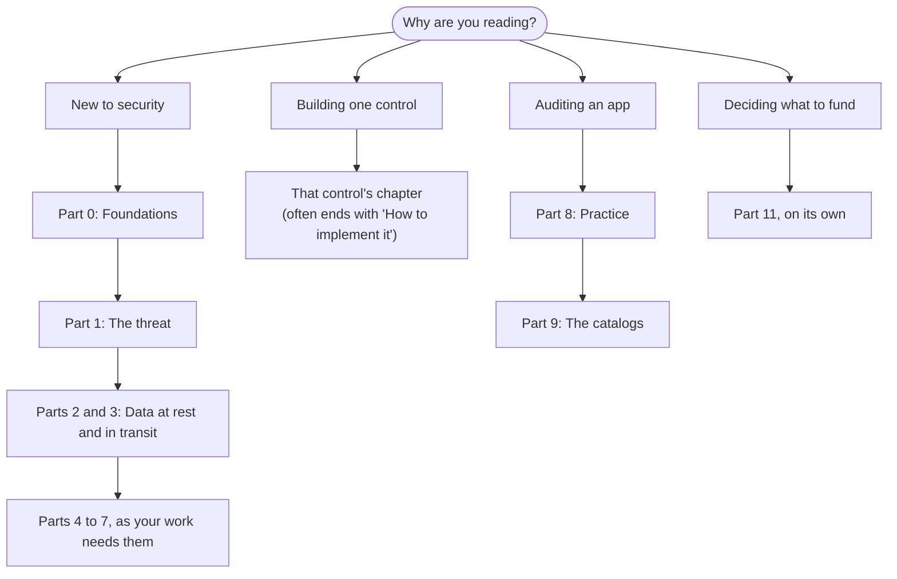

# Mobile Application Security

### A Study Book for Engineers

**Edition 1 · September 2026, updated October 2026**
Hossam Atef — Software Engineer
Android · iOS · Kotlin Multiplatform

---

## Start here

Run `strings` (a command-line tool that prints every run of readable text in a file) over your own release build; [Chapter 1](01-understanding-the-threat.md)'s **Try it** shows how. It takes thirty seconds. Anyone who downloads your app can already read whatever it prints: API keys, internal hostnames, a debug flag someone forgot. For most engineers, that's the moment mobile security stops being theory.

This book teaches you to secure a mobile app. More importantly, it teaches you to *reason* about mobile security, so you can handle the cases no book covers. It rests on one idea: **your app runs on a device you don't control.** Whoever controls that device, often its owner, can read your app's files, decompile its code, and change how it runs. Most good designs follow from taking that seriously. Most bad designs come from forgetting it.

**You don't need a security background.** If you can build and ship a mobile app, you can read this. Part 0 covers the foundations: what encryption does, how sign-in works, and what the platforms protect for free. I define every term where it first appears, and the [glossary](12-verification.md#glossary) collects them.

**You do need to be willing to run things.** Take certificate pinning, where your app accepts only the server certificates it expects. Reading about how an attacker switches pinning off teaches you little. Doing it to your own app teaches you a great deal. Most chapters end with a **Try it** exercise you can finish in under an hour, and [Part 8](08-practice.md) shows you how to build a test lab.

### What you'll learn

By the end of this book, you'll be able to:

- Describe what an attacker can do to your app, and explain why the usual instinct (hide the secret better) doesn't work.
- Choose where to store sensitive data on Android and iOS, and justify the choice.
- Explain how hardware-backed keys work, well enough to answer "what happens when StrongBox isn't available?" without guessing. A hardware-backed key stays inside isolated secure hardware (a protected area of the main processor, or a separate security chip) and never reaches your app's memory; StrongBox is Android's optional, separate security chip.
- Decide whether to pin certificates, choose between static, dynamic, and hybrid pinning (pins built into the app, pins fetched at runtime, or both), and defend the answer.
- Implement device attestation (the platform vouching that a request comes from your genuine app on a genuine device) and biometric authentication so that your server makes the decision, not a function an attacker can intercept and rewrite at runtime. You get working code for both platforms.
- Secure your build pipeline, which is now often an easier target than the app itself.
- Threat-model a feature: work out what can go wrong with it and who would try. That includes new kinds of feature, such as AI assistants and AI agents that take actions on the user's behalf.
- Test your own work and write findings someone can act on.
- Read OWASP's mobile application security standard and speak its vocabulary. (OWASP, the Open Worldwide Application Security Project, is a nonprofit that publishes free security standards.)

---

## How to read this book

The parts build on each other, but you don't have to read them in order. Pick the path that matches why you're here.

*Figure 1: Reading paths through the book, by reason for reading*

- **New to security?** Read Parts 0 to 3 in order and do each **Try it**. That's about a week of evenings *(estimate)*. Then read Parts 4 to 7 as your work needs them.
- **Implementing one control?** Go straight to its chapter. Many control chapters end with a "How to implement it" section that has code for both platforms. If the chapter uses a term you don't know, the glossary points you to the section that teaches it.
- **Auditing an app?** Read [Part 8](08-practice.md), then work through the OWASP catalogs in [Part 9](09-the-catalogues.md).
- **Deciding whether to fund this work?** Read [Part 11](11-making-the-case-and-running-the-programme.md) on its own. It needs nothing else.
- **Preparing for an interview, or checking yourself?** Answer the questions in [Part 10](10-questions-and-answers.md) before you reread anything, then reread the chapters behind the answers you got wrong.

### The parts

| Part | Chapters | What it covers |
|---|---|---|
| [0 — Foundations](00-foundations.md) | 0.1–0.6 | Vocabulary, the cryptography you need, authentication and OAuth on mobile, what the platforms give you for free, threat modeling, and asset classification |
| [1 — Understanding the threat](01-understanding-the-threat.md) | 1–3 | What an attacker can do, what breaches and leaks cost, and how the OWASP Mobile Application Security (MAS) standard fits together |
| [2 — Data at rest](02-data-at-rest.md) | 4–6 | Keystore and Keychain internals, key attestation, choosing storage, and database encryption |
| [3 — Data in transit](03-data-in-transit.md) | 7–8 | TLS, the certificate pinning debate, static versus dynamic pinning, implementation, and troubleshooting |
| [4 — Proving who is calling](04-proving-who-is-calling.md) | 9–12 | Play Integrity (Android), App Attest (iOS), biometrics, and the backend as the only real arbiter |
| [5 — Resilience](05-resilience.md) | 13–14 | How reverse engineering works, obfuscation and tamper detection, and detection code |
| [6 — The build and release pipeline](06-the-build-and-release-pipeline.md) | 15 | Why CI (continuous integration) is now the target, secrets, workflow hardening, signing keys, and build configuration |
| [7 — Platform surfaces and new frontiers](07-platform-surfaces-and-new-frontiers.md) | 16–21 | WebViews, IPC (inter-process communication) and deep links, permissions and privacy, input validation, AI features, and Kotlin Multiplatform. Most real assessment findings come from these surfaces *(reasoned)* |
| [8 — Practice](08-practice.md) | 22–25 | Build a test lab (22), run an assessment and write it up (23), handle an incident (24), and a one-page testing checklist (25) |
| [9 — The catalogs](09-the-catalogues.md) | 26–28 | The 24 MASVS controls (what must be true), the 78 MASWE weaknesses (what goes wrong), and the MASTG tests and techniques (how to check) worth knowing |
| [10 — Questions and answers](10-questions-and-answers.md) | — | About 160 questions with written-out answers, tagged by difficulty, including design-review scenarios |
| [11 — Making the case](11-making-the-case-and-running-the-programme.md) | 29–32 | Business case, regulation, what comparable teams do, and a phased plan with owners and testable success criteria. Written to stand alone |
| [12 — Verification](12-verification.md) | 33 | Audit log, known uncertainties, sources, and glossary |

---

## A few conventions

**Sources.** When a claim rests on a number or a specification, I link the source. When I'm summarizing a standard rather than quoting it, I say so.

**Disagreement.** Where the industry disagrees, you get both arguments rather than a quiet verdict. On some questions, certificate pinning above all, it disagrees sharply. You'll be the one in the design review, so you need to be able to argue either side.

**Traps.** This subject has more traps than you'd expect, and most of them look like working code. The book flags every one the same way:

> **Trap:** a callout like this marks a mistake that looks correct. Slow down when you see one.

You'll also see `> **Why it matters:**` for the reason behind a rule, `> **In practice:**` for how a rule plays out on a real team, and `> **Evidence:**` where the book records a test that was run and what it showed.

**Chapter endings.** Most chapters close with **Key takeaways** (three to five points worth remembering) and **Try it** (one to three exercises you can finish in under an hour, on your own app or on a deliberately vulnerable practice app from the [OWASP MASTG app list](https://mas.owasp.org/MASTG/apps/)).

**Diagrams.** The book draws flows, stacks, and trust boundaries (the points where data crosses from code you control to code you don't) as [Mermaid](https://mermaid.js.org/) diagrams. They render on GitHub and in most Markdown viewers.

### On confidence

Not every claim in a book like this rests on equally solid ground, and hiding that would make the book less useful. Where a claim is weaker than it looks, it carries one of these markers:

| Marker | Meaning |
|---|---|
| *(reported)* | A figure from vendor or practitioner write-ups rather than a primary source or forensic report. The mechanism is corroborated; the exact number may not be. |
| *(estimate)* | A planning figure, not a measurement. Scale it to your own situation. |
| *(reasoned)* | A conclusion this book draws by analogy or first principles, not something quoted from a standard. Sound, but yours to check. |
| *(contested)* | The industry disagrees, and you get both sides. |
| *(illustrative)* | A made-up scenario or example, used to show a mechanism. Not a report of a real event. |

Everything unmarked traces to a primary or authoritative source: a standards body, platform vendor documentation, or an official report. [Chapter 33](12-verification.md) records what was verified, when, and what was corrected along the way.

### On verification

Most implementation sections end with a **Verify it** block: the command to run and the pass or fail criterion. I wrote them from documented tool behavior and from the OWASP MASTG test procedures. **Most haven't been run against a live app.** Where one was run, on an emulator or simulator, the chapter says so in an `Evidence` note. Each block describes the expected output rather than inventing one, and says so where behavior varies by device or OS version. Treat them as a test plan, not a transcript. If you run one and get a different result, that's the most useful correction you can send me.

### On the code

Many chapters covering a control end with a "How to implement it" section. It gives short, correct implementations in Kotlin for Android and Swift for iOS. Where a mistake is common, it shows the wrong version next to the right one, which teaches faster than pages of prose. For example, you'll see `CBC` beside `GCM` (only GCM detects tampering), and `biometryAny` beside `biometryCurrentSet` (only the second stops working when someone enrolls a new fingerprint or face). The snippets are deliberately short: enough to adapt, but not a substitute for the platform documentation, which each chapter links.

### On dates

Mobile security moves fast. Platform versions, attestation behavior, certificate lifetimes, and the OWASP catalogs all change within a year. Each part file records in its frontmatter when it was last checked (`last_verified`) and how quickly it decays (`volatility`). This edition reflects the state of things in **October 2026**: Android 17 (released June 2026) and iOS 27 (released 14 September 2026) are the newest platform versions. iOS 26 still runs on most iPhones *(reasoned)*. Android devices are spread across many versions: in Google's December 2025 figures, Android 15 was the most common at about 19%, and Android 16 had reached about 7.5% *(reported)*. The OWASP catalogs are at MASVS v2.1.0, MASWE v1.0.0, and MASTG v2.0.0. Where behavior differs between recent versions, the text says which version it means.

---
